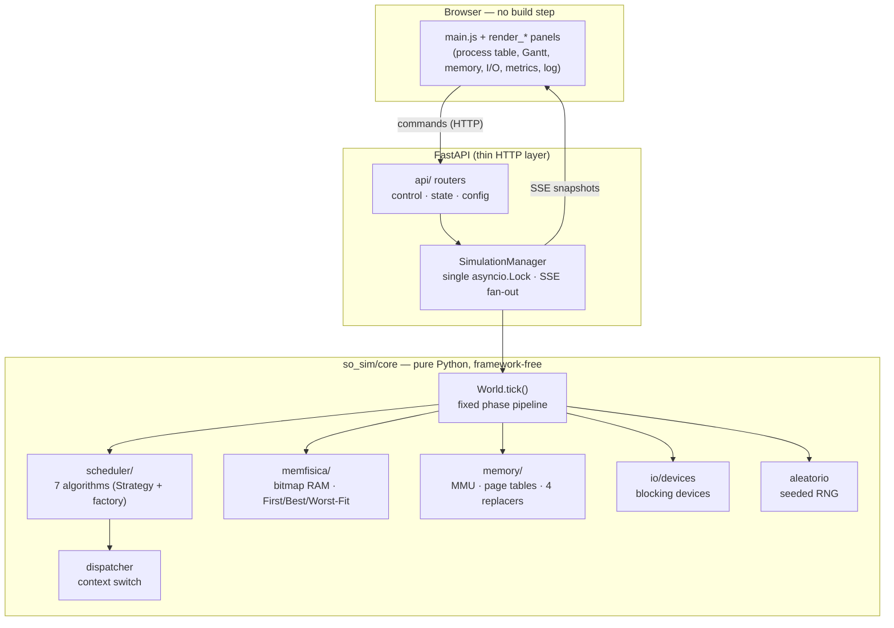

# OS Simulator

**An interactive, web-based operating-system simulator that runs CPU scheduling, virtual-memory paging, and blocking I/O devices on a single logical clock.**


---

## Overview

OS Simulator is an educational simulator that brings three operating-system mechanisms that most course projects treat in isolation onto **one shared logical clock**: process scheduling, virtual memory / paging, and blocking I/O devices. Every tick advances the whole machine through a fixed, documented sequence of phases, so you can watch a process get admitted, loaded into physical RAM, dispatched onto the CPU, take a page fault, block on a device, and terminate, all in one coherent timeline.

The core is **dependency-free Python** and fully unit-tested; a thin FastAPI layer streams state snapshots over Server-Sent Events, and a **no-build** HTML/CSS/JavaScript frontend re-renders a live process table, Gantt chart, memory map, device queues, and metrics from each snapshot. The interesting engineering is the integration itself: making three subsystems share a single deterministic clock is meaningfully harder than building three separate mini-simulators, and this project does it while staying clean, testable, and reproducible.

## Features

- **Single-clock integration of three subsystems.** `World.tick()` runs one explicit phase pipeline per tick: process admission and loading into physical RAM, scheduling / preemption and context-switch dispatch, virtual-memory paging, burst execution (program-counter advance), burst-end / error / I/O blocking, device advancement (I/O completion interrupts), and accounting.
- **Seven CPU scheduling algorithms** behind a Strategy/factory design: FCFS, SJF, SRTF, Round Robin, non-preemptive Priority, preemptive Priority, and a two-level MLQ (high queue = Round Robin, low queue = FCFS).
- **A full PCB state machine** — `NEW → READY → RUNNING → BLOCKED → TERMINATED`, plus an `ERROR` state — with a dedicated dispatcher that separates context-switch execution from the scheduling decision.
- **Two coexisting memory models:**
  - **Physical RAM** — bitmap-managed contiguous memory with pluggable **First-Fit / Best-Fit / Worst-Fit** placement and internal/external fragmentation metrics.
  - **Virtual memory (PLUS module)** — per-process page tables, a limited pool of physical frames, an MMU that translates virtual to physical addresses and services **page faults**, and **four page-replacement algorithms**: FIFO, LRU, Belady's Optimal, and Clock / Second-Chance.
- **Blocking I/O devices** that block and unblock processes, including an **interactive keyboard device** that pauses the simulation for a real user *Cancel / Continue* decision.
- **Fully reproducible runs.** A dedicated seeded RNG (even error injection uses its own seeded generator) makes every run deterministic — which is what enables reliable tests, fair algorithm comparisons, and a computable Belady's-Optimal replacer.
- **Headless comparison engine.** Reruns the same scenario across all mandatory schedulers and all placement strategies to produce comparative metric tables, **exportable to CSV**, including a micro-benchmark that actually differentiates First/Best/Worst-Fit.
- **Live web UI with no build step.** Server-Sent-Events snapshots drive idempotent, per-panel re-renders: process table, Gantt chart, memory frames, device queues, metrics, and an event log.
- **One-click demo scenarios**, including a seeded 20-process benchmark.

## Architecture

The project is layered on purpose, with a **framework-free core** so the OS logic is unit-testable in complete isolation from the web layer.

- **`so_sim/core/` — pure Python, no framework.** `world.py` is the orchestrator that runs the fixed phase pipeline each tick; `pcb.py` holds the process control block plus declarative memory/I-O plans; `scheduler/` is a Strategy family behind a `get_scheduler` factory; `memfisica/` is bitmap physical RAM with pluggable placement strategies; `memory/` is the paging subsystem (frame pool, MMU, page tables, replacement strategies); `io/devices.py` models device queues; `dispatcher.py` isolates context switching from the scheduling decision; `aleatorio.py` is the seeded RNG; `comparativa.py` runs the headless multi-run comparisons.
- **`so_sim/manager.py` — the single async boundary.** `SimulationManager` owns the `World`, drives the play loop under one `asyncio.Lock` (guaranteeing the play loop and manual stepping never tick concurrently), and fans stateless snapshots out to SSE subscriber queues.
- **`so_sim/api/` — a thin FastAPI router set** (control / state / config) with Pydantic schemas; `app.py` wires the routers and serves static files.
- **`so_sim/static/` — a no-build ES-module frontend.** `main.js` subscribes to the stream and idempotently calls per-panel render modules from each snapshot, so the client holds no hidden state.



**Why it's designed this way:** the core has no knowledge of FastAPI, so it can be exercised entirely through `pytest`. The web layer only marshals commands in and streams snapshots out; because those snapshots are stateless and the client re-renders idempotently, there is no hidden client state to drift out of sync with the simulation.

## Tech Stack

| Layer | Technology |
| --- | --- |
| Core engine | Python 3.10+ (standard library only, zero runtime dependencies) |
| HTTP / streaming | FastAPI, Uvicorn, Pydantic v2, Server-Sent Events |
| Frontend | Vanilla HTML + CSS + JavaScript ES modules (no build tooling) |
| Testing | pytest (~31 tests across 8 files) |

## Getting Started

**Prerequisites:** Python 3.10 or newer.

### Windows (one command)

```bat
run.bat
```

`run.bat` creates a virtual environment, installs the dependencies, opens your browser at `http://127.0.0.1:8000`, and starts the server.

### macOS / Linux / manual setup

```bash
# 1. Create and activate a virtual environment
python -m venv .venv
source .venv/bin/activate          # Windows: .venv\Scripts\activate

# 2. Install dependencies
pip install -r requirements.txt

# 3. Run the server
python -m uvicorn so_sim.app:app
```

Then open **http://127.0.0.1:8000** and load one of the built-in demo scenarios to start ticking the clock.

> **Note:** the FastAPI layer has no authentication, CORS, or rate limiting, and the manager holds a single global simulation instance. This is intentional — it is a **local, single-user demo**, not a multi-tenant service.

## Project Structure

```
simulador-so/
├─ so_sim/
│  ├─ core/                     # Pure-Python engine (no framework)
│  │  ├─ world.py               # Orchestrator: the per-tick phase pipeline
│  │  ├─ pcb.py                 # Process control block + declarative plans
│  │  ├─ dispatcher.py          # Context-switch execution
│  │  ├─ aleatorio.py           # Seeded, reproducible RNG
│  │  ├─ comparativa.py         # Headless multi-run comparison engine
│  │  ├─ scheduler/             # FCFS · SJF · SRTF · RR · Priority · MLQ
│  │  ├─ memfisica/             # Bitmap RAM + First/Best/Worst-Fit
│  │  ├─ memory/                # MMU, page tables, 4 replacement algorithms
│  │  ├─ io/devices.py          # Blocking I/O devices
│  │  └─ metrics.py · serialize.py · config.py · enums.py · events.py
│  ├─ manager.py                # SimulationManager: async boundary + SSE
│  ├─ api/                      # Thin FastAPI routers + Pydantic schemas
│  ├─ app.py                    # Wires routers, serves static files
│  ├─ scenarios/presets.py      # One-click demos (incl. 20-process benchmark)
│  └─ static/                   # No-build ES-module frontend (index + render_*)
├─ tests/                       # pytest suite (~31 tests, 8 files)
├─ requirements.txt
└─ run.bat                      # Windows one-command launcher
```

## Tests

The core engine is covered by a `pytest` suite of roughly 31 tests across 8 files, exercising schedulers, physical memory, paging, the dispatcher, I/O, PCB state transitions, RNG determinism, and per-tick invariants.

```bash
pip install pytest
python -m pytest
```

Test files: `test_schedulers`, `test_memoria_fisica`, `test_memory`, `test_dispatcher`, `test_io`, `test_estados`, `test_aleatorio`, `test_world_tick`.

## Project Context

This is a **university final project** for an Operating Systems course. It was built to demonstrate the core mechanics of a real operating system — scheduling, memory management, and I/O — in a single, observable, reproducible simulation. Portions of the source (identifiers, comments, and the original documentation) were written in Spanish; this README is the English entry point for reviewers.

---

## More of my work

Sibling portfolio repositories:

- [minipython-interpreter](https://github.com/mazk36/minipython-interpreter) — a Python-subset interpreter
- [os-simulator](https://github.com/mazk36/os-simulator) — this project
- [advanced-algorithms](https://github.com/mazk36/advanced-algorithms) — algorithm implementations and studies
- [Pinguino](https://github.com/mazk36/pinguino-monitoring) — Flask + React monitoring dashboard

---

**Author:** Marcelo Jáuregui — [github.com/mazk36](https://github.com/mazk36)

*Licensed under the MIT License.*
